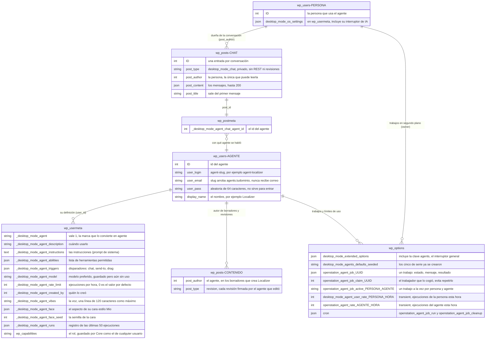

# Anexo: dónde guardan sus datos los agentes

Anexo del [plan del webinar](plan.md). Nombres comprobados contra `trunk` de OpenStation el 26/09/2026, con #902 y #903 ya fusionados.

**La idea en una frase:** los agentes no crean tablas propias. Todo vive en las tablas de siempre de WordPress (`wp_users`, `wp_usermeta`, `wp_posts`, `wp_postmeta`, `wp_options`), más una carpeta en `uploads` para las caras.

> Los nombres guardados siguen diciendo `desktop_mode` (el nombre antiguo del plugin) a propósito. Ya están escritos en bases de datos reales, y cambiarlos dejaría los datos huérfanos.

## El diagrama

Si tu visor no dibuja Mermaid, tienes el mismo diagrama como imagen: [`anexo-datos-agentes.png`](anexo-datos-agentes.png).

## Tabla por tabla

### `wp_users`: el agente es un usuario

Una fila por agente, como cualquier usuario. El email es sintético y la contraseña aleatoria, y OpenStation bloquea todas las vías de inicio de sesión, aunque se apague la función de agentes. El rol se guarda donde Core guarda siempre los roles (`wp_capabilities` en `wp_usermeta`).

### `wp_usermeta`: la definición del agente

Todo lo que define a un agente son metadatos de su propio usuario: instrucciones, herramientas, disparadores, voz, cara y límites. No aparecen en el endpoint `wp/v2/users` de Core, pero cualquiera que pueda usar agentes (`edit_posts`) puede leer las instrucciones por la API de agentes. **No pongas secretos en las instrucciones.**

`_desktop_mode_agent_runs` es un registro de auditoría de las últimas 50 ejecuciones: quién lo lanzó y los primeros 600 caracteres del mensaje y de la respuesta. De momento solo se lee desde PHP; no tiene pantalla.

### `wp_posts` + `wp_postmeta`: las conversaciones

Cada conversación es una entrada privada del tipo `desktop_mode_chat`:
- El autor es la **persona**, no el agente. Solo esa persona puede leerla, ni siquiera un administrador por la API.
- Los mensajes van en JSON dentro de `post_content`.
- El id del agente va en el metadato `_desktop_mode_agent_chat_agent_id`.
- Límites: 100 conversaciones por persona (al pasar de 100 se borran las que llevan más tiempo sin usarse) y 200 mensajes por conversación.
- Se guarda qué herramientas usó el agente y con qué argumentos, pero **no** lo que devolvieron.
- ¿Por qué entradas y no metadatos de usuario? WordPress carga todos los metadatos de un usuario de golpe, y guardar ahí transcripciones largas haría más lenta cada petición.

### `wp_posts`: el contenido que tocan los agentes

Aquí no hay nada especial, y precisamente esa es la gracia:
- Un borrador creado por Localizer tiene a Localizer como `post_author`.
- Cuando tl;dr edita una entrada, Core guarda una revisión con tl;dr como autor.

Por eso "qué hizo cada agente" se ve en las pantallas de siempre: Revisions y la lista de entradas filtrada por autor.

### `wp_options`: trabajos en segundo plano, límites y ajustes

- `desktop_mode_extended_options`: el interruptor general de agentes (la clave `agents`).
- `desktop_mode_agents_defaults_seeded`: marca que los cinco de serie ya se crearon; por eso no vuelven aunque los borres.
- `openstation_agent_job_{uuid}`, `openstation_agent_job_claim_{uuid}` y `openstation_agent_job_active_{persona}_{agente}`: cada petición al agente es un trabajo en segundo plano. Llevan `autoload` desactivado, caducan a las 2 horas y se borran al día.
- Los límites de uso son *transients* por hora: 120 ejecuciones por persona y 60 por agente. Con una caché de objetos (Redis, Memcached) viven ahí en lugar de en `wp_options`.
- El cron de WordPress (la opción `cron`) programa `openstation_agent_job_run`, que ejecuta el trabajo, y `openstation_agent_job_cleanup`, que lo limpia.

### Fuera de la base de datos: las caras

`wp-content/uploads/desktop-mode-agent-faces/{id}-{hash}.svg`: la cara de cada agente, dibujada en PHP al guardarlo, para que `get_avatar()` funcione en cualquier parte sin coste. La carpeta lleva un `.htaccess` que impide ejecutar PHP (en servidores Apache).

## Lo que OpenStation NO guarda

- **La API key del proveedor de IA.** Está en los Conectores de WordPress (Settings → Connectors); OpenStation nunca la toca.
- **Lo que devuelven las herramientas.** Ni en las conversaciones ni en el registro.
- **Índices ni embeddings de tu contenido.** No hay análisis en segundo plano; el agente lee lo que le mandas, cuando se lo mandas.
